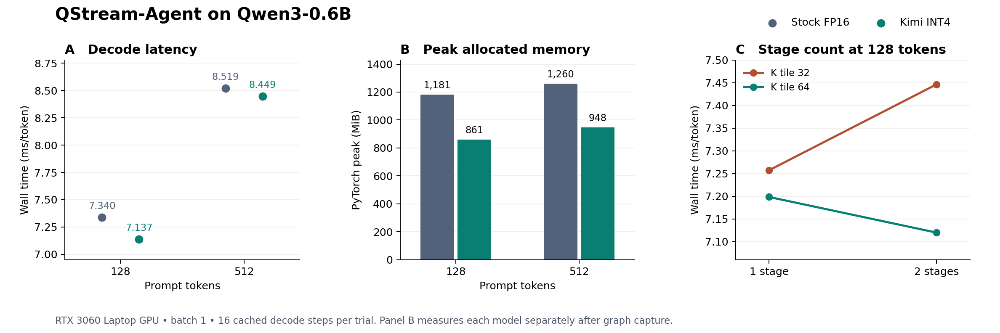

# QStream-Agent · Checkpoint 3

## End-to-end result

QStream-Agent integrated packed INT4 feed-forward weights and the validated Triton W4A16 kernel into all 28 Qwen3-0.6B layers. On an RTX 3060 Laptop GPU, the selected launch reduced peak allocated memory by **311–320 MiB** and reduced batch-1 decode latency by **0.87–2.76%** versus stock FP16 when both used CUDA Graphs. The result applies to cached decode at the two tested prompt lengths. Stock FP16 scored better on the small fixed-text regression set.



| Prompt length | Stock FP16 ms/token | Selected INT4 ms/token | Paired latency reduction | Peak allocated MiB, FP16 / INT4 |
| ---: | ---: | ---: | ---: | ---: |
| 128 | 7.340 | 7.137 | 2.76% | 1,180.65 / 860.66 |
| 512 | 8.519 | 8.449 | 0.87% | 1,259.54 / 948.08 |

INT4 won all ten pairs at each length. Each graph exactly matched its own static-cache eager reference. Timing includes the token and position copies and 16 fixed decode steps. Prefill is performed before each interval. Peak allocated memory is measured with one model resident at a time, after capture, over prefill and the decode sequence. Model storage fell from 1,136.88 to 766.75 MiB. [Protocol and raw measurements](final-checks/REVIEW.md)

## How the project got here

1. **Checkpoint 1 established the quantization and execution baseline.** It implemented groupwise INT4 packing and a SwiGLU reference, then compared independent gate and up projections under sequential and two-stream scheduling. [Packing and SwiGLU source](../qstream.py)
2. **Checkpoint 2 built and validated a fused Triton W4A16 projection.** The selected version loads packed bytes, decodes signed nibbles, and applies group scales before the dot product. It combines the cheaper signed decode and the safe two-scale lookup. [Selected kernel](../stage23/combined/candidate.py) · [Correctness receipt](../stage23/combined/full-receipt.json)
3. **Checkpoint 3 moved the projection into Qwen.** In the initial eager benchmarks, stock FP16 was faster than the original packed path in both prefill and decode across the tested workloads. CUDA Graph replay reduced the packed batch-1 decode time from 37.334 to 7.652 ms per token in a paired static-cache experiment. Profiling replay pointed to the down projection. A separate warmed Nsight capture showed that it launched 16 blocks on 30 SMs and that no warp was ready to issue on 81.5% of measured scheduler cycles. A manual change from 64 to 32 outputs per block doubled the grid and improved decode by about 5.2% versus the original packed graph. [Initial prefill and decode](timing/REVIEW.md) · [CUDA Graph comparison](graph-decode/REVIEW.md) · [Replay profile](graph-profile/REVIEW.md) · [Nsight profile](down-profile/REVIEW.md) · [Manual baseline](tile-width/REVIEW.md)

## What Inco contributed

Kimi K3.1 Pro Standard chose among seven allowed Triton launch settings through Inco. The prompt included hardware counters and prior full-model timing. The local evaluator kept the weight representation and verified kernel source fixed, checked the selected launch against a reconstructed-weight projection and two model sequences, and timed it only after correctness passed.

The original three-round search returned one usable configuration. It used 32 outputs, a 64-wide reduction tile, four warps, and two stages. It improved decode from 7.223 to 7.090 ms per token in its paired test. The two later requests exhausted their 8,192-token caps with empty final answers. In separate higher-cap repeats, both returned the same usable configuration with a 32-wide reduction tile and two stages. It was slower in both GPU sessions. Both replies used fewer than 8,192 tokens, so these repeats do not isolate the effect of raising the cap. There was no matched search without feedback in Checkpoint 3, so the experiment cannot establish whether providing feedback improved search effectiveness. [Prompts, API receipts, and candidate history](decode-search/REVIEW.md)

## Why the selected configuration stayed

The same-session four-way test held output width at 32 and warp count at four. A second stage increased latency by **2.61%** at reduction width 32 and reduced it by **1.11%** at width 64. The selected launch beat the manual baseline in all 12 rounds. This establishes that the stage setting interacts with reduction width for this workload. The test did not collect new hardware counters to identify the source of the interaction. [Four-way measurements](final-checks/REVIEW.md)

On held-out prompt lengths of 64, 256, and 512, the selected launch reduced latency by **1.63–1.90%** versus the manual packed launch and won all 30 pairs. On eight new passages, the two INT4 variants agreed on all 256 top predictions and differed by 0.00052 nats in mean next-token loss. Perplexity on these passages was 53.97 for stock FP16, 66.13 for manual INT4, and 66.16 for the selected INT4 launch. The stock reference used a full forward, while the two packed variants used cached decode. This small regression set supports keeping the launch change within INT4. It does not establish FP16-equivalent model quality. [Held-out methodology and measurements](heldout/REVIEW.md)

## Run the demo

From the repository root in the prepared WSL Ubuntu 22.04 environment:

```bash
bash stage30/demo.sh
```

Bash enters the project, selects the local dependencies and caches, and starts the offline precision comparison without an Inco key. It prints side-by-side latency and memory and writes a new JSON receipt. The comparison uses the pinned Qwen revision `c1899de289a04d12100db370d81485cdf75e47ca`, PyTorch 2.9.1+cu130, Triton 3.5.1, Transformers 4.57.6, and driver 596.08 on the measured workstation. The [setup guide](../README.md) documents the local model and Python environment. The [reproduction commands](REPRODUCE.md) include figure generation.

The packaging verification reproduced the same peak allocated memory values. INT4 again won all 20 timing pairs, with paired reductions of 2.55% at 128 tokens and 0.56% at 512. The table and figure above use the original benchmark receipt. [Demo verification receipt](final-checks/demo-validation.json)
